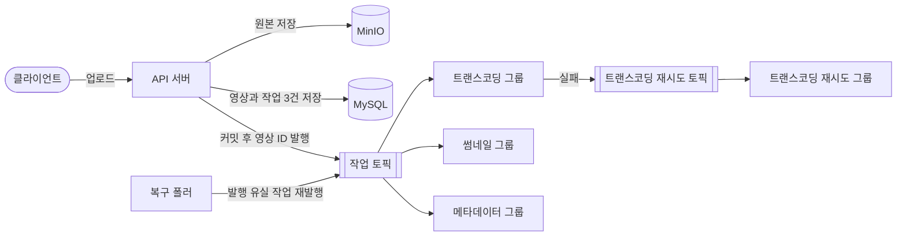

# TransCourse

> 강의 영상 업로드 이후 필요한 후처리 작업을 안정적으로 수행하는 시스템

---

## 1. 프로젝트 소개

### Background

강의 영상을 올리는 서비스는 업로드 이후 여러 후처리를 거칩니다.

* 영상 썸네일 생성
* 영상 길이, 해상도, Codec 등의 메타데이터 추출
* 스트리밍을 위한 영상 트랜스코딩

썸네일과 메타데이터는 2초 안에 끝나지만, 트랜스코딩은 실제 강의 영상 기준 한 건당 수십 분이 걸린다고 가정하고 설계했습니다. 실험에는 4분 길이 영상을 사용했고, 여러 건이 동시에 처리될 때 한 건당 평균 1.5~3분이 걸렸습니다. 실패 가능성도 작업마다 다르며, 하나의 영상에 대해 여러 작업이 독립적으로 수행되어야 합니다.

여러 인스턴스가 이 작업들을 나눠 처리할 때 업로드와 후처리를 어떤 구조로 연결해야 하는지 직접 구현하며 검토하고자 이 프로젝트를 시작했습니다.

### Goal

다음 요구사항을 만족하는 영상 후처리 시스템을 구현하는 것을 목표로 합니다.

* 영상 업로드와 시간이 오래 걸리는 후처리 작업이 서로 불필요하게 영향을 주지 않을 것
* 각 후처리 작업을 독립적으로 수행할 수 있을 것
* 특정 후처리 작업이 실패한 경우 해당 작업만 다시 수행할 수 있을 것
* 하나의 작업 실패가 다른 후처리 작업의 재실행으로 이어지지 않을 것
* 동일한 작업이 다시 수행되더라도 결과의 일관성을 유지할 수 있을 것
* 새로운 후처리 기능을 기존 로직의 큰 변경 없이 추가할 수 있을 것

---

## 2. 구조



* 업로드 한 번에 영상 ID 한 건 발행
* 처리 유형마다 독립된 컨슈머 그룹과 오프셋
* 재시도 레코드는 헤더에 대상 유형을 담아 해당 유형의 그룹만 처리

---

## 3. 기능 목록

### 영상 업로드

* 원본을 MinIO에 저장하고 영상과 유형별 작업 3건을 한 트랜잭션으로 저장
* 커밋 이후 작업 토픽에 영상 ID 발행
* 예외: 빈 파일 업로드 시 400
* 예외: DB 저장 실패 시 저장한 원본 삭제
* 예외: 발행 실패 시 작업은 대기 상태로 남고 복구 폴러가 재발행

### 썸네일 생성, 메타데이터 추출

* 썸네일 이미지 생성과 저장
* 영상 길이, 해상도, 코덱 추출
* 예외: 실패 시 같은 레코드를 지수 백오프로 최대 3회 실행
* 예외: 3회 모두 실패 시 재시도 소진 상태

### 트랜스코딩

* 720p 단일 렌디션의 HLS 변환과 저장
* 4초 세그먼트 경계마다 키프레임 강제 삽입
* 예외: 실패 시 재시도 토픽으로 전달하고 예정 시각까지 대기 후 실행
* 예외: 3회 모두 실패 시 재시도 소진 상태
* 예외: 리밸런싱으로 재전달된 레코드는 새 시도로 처리하고 이전 시도의 완료 기록 거부

### 상태 조회와 산출물 접근

* 영상별 전체 상태와 작업별 상태 조회
* 썸네일 presigned URL 발급
* 세그먼트 URL을 서명한 HLS 플레이리스트 제공
* 예외: 산출물이 준비되지 않은 경우 409

### 수동 재시도

* 작업 단위 재시도 API
* 예외: 재시도 소진 상태가 아닌 작업의 재시도 요청 시 409

---

## 4. 설계 결정

### 장시간 트랜스코딩의 소비 방식

인코딩 시간이 `max.poll.interval.ms`를 넘기므로 리스너 스레드에서 직접 실행할 수 없습니다.

* 레코드를 한 건씩 받아 해당 파티션을 pause하고 별도 워커 스레드에서 실행
* 완료 후 수동 ack와 resume
* pause와 resume은 워커 스레드에서도 호출할 수 있는 리스너 컨테이너의 API로 요청
* 동시 실행 수의 상한은 할당받은 파티션 수

### 재전달과 시도 번호 (attemptCount fencing)

at-least-once 소비에서는 같은 작업이 두 번 실행될 수 있습니다.

* 실행 중인 작업의 레코드가 재전달되면 새 시도로 처리하고 시도 번호 증가
* 먼저 실행 중이던 시도의 완료 기록은 시도 번호 불일치로 거부
* 산출물 저장 경로는 원본 경로에서 파생된 고정 경로라 재실행 시 같은 위치에 덮어쓰기

시도 번호는 완료 기록만 막습니다. 먼저 실행 중이던 시도의 인코딩은 중단되지 않습니다.

### 재시도

* 썸네일과 메타데이터: `DefaultErrorHandler`의 지수 백오프 기반 블로킹 재시도
* 트랜스코딩: 워커 스레드가 재시도 토픽에 발행한 뒤 원본 레코드 ack
* 재시도 횟수는 에러 핸들러와 재시도 레코드 헤더로 관리하고, DB에는 실패와 재시도 소진 상태만 기록

### 폐기한 대안

| 대안 | 폐기 이유 |
|---|---|
| 폴러의 실행 시간 초과 판정 | 300초를 넘는 정상 인코딩을 멈춘 작업으로 오판 |
| `CompletableFuture`를 반환하는 비동기 리스너 | ack 대기 동안 컨슈머 전체가 pause되어 파티션별 병렬 처리 불가, 아래의 파티션 정지 |

### 비동기 리스너의 파티션 정지

재시도를 `@RetryableTopic`으로 옮기며 트랜스코딩 리스너가 `CompletableFuture`를 반환하도록 바꿨습니다. CooperativeSticky 회차에서 할당이 유지된 파티션이 에러 없이 멈췄고, 레코드 2건이 8분 넘게 처리되지 않았습니다.

* spring-kafka 4.1.1의 비동기 ack 대기 중 컨슈머 전체 pause
* Cooperative revoke 처리에서 pause 플래그만 해제하고 resume은 미호출
* Range는 리밸런싱마다 전체 파티션을 재할당해 pause가 풀리므로 미발생

설정으로 피할 수 없는 경로라 파티션 단위 pause와 수동 ack 구조로 되돌렸습니다. 되돌린 구조로 리밸런싱 비용 실험을 다시 수행했고, CooperativeSticky 4회 모두 정지된 파티션은 없었습니다. 같은 지점이 이후 spring-kafka [#4708](https://github.com/spring-projects/spring-kafka/issues/4708)로 수정되었습니다.

---

## 5. 리밸런싱 비용 실험

트랜스코딩 그룹의 컨슈머 3대, 파티션 6개에서 인코딩 도중 1대를 증설했습니다. 할당 전략별로 4회씩 측정한 평균입니다.

처음에는 전체 파티션의 revoke를 중복 인코딩의 원인으로 가정했습니다. 리밸런싱 로그와 레코드별 실행 이력을 대조한 결과, 중복은 다른 컨슈머로 이동한 파티션에서만 발생했습니다. 그래서 revoke 범위가 아닌 파티션 이동 수를 비교 기준으로 잡았습니다.

| 항목 | Range | Sticky | CooperativeSticky |
|---|---|---|---|
| revoke 파티션 | 6 | 6 | 1 |
| 이동 파티션 | 2 (회차별 5, 1, 1, 1) | 1 | 1 |
| 낭비된 인코딩 시간 비율 | 16.2% (최대 35.7%) | 11.2% (최대 11.8%) | 11.3% (최대 11.8%) |
| 유지 파티션의 재전달 | 3.5 | 4.5 | 0 |

* 할당이 유지된 파티션의 재전달은 진행 중 작업이 끝난 뒤 도착해 모두 SKIPPED 처리
* Range의 이동 수는 신규 멤버 ID의 정렬 위치에 따라 변동
* Sticky와 CooperativeSticky의 비용은 동일

기본 할당 전략은 `CooperativeStickyAssignor`입니다. 선택 근거는 비용 차이가 아닙니다. 유지 파티션을 revoke하지 않아 리스너 컨테이너의 pause 재적용에 의존하지 않는다는 점입니다.

조건, 재현 절차, 회차별 값은 [실험 문서](docs/experiments/kafka-rebalance/README.md)에 있습니다.

---

## 6. 알려진 한계

* 증설 때 새 컨슈머로 이동하는 파티션의 중복 인코딩으로 남는 약 11%의 낭비
* 복구 폴러가 토픽에서 대기 중인 작업까지 재발행하는 중복 ([#30](https://github.com/choyoungseo20/transcourse/issues/30))
* 실험용 계측 코드의 상시 동작과 리밸런싱 콜백 안의 DB 쓰기
* 컨슈머는 정상이고 ffmpeg 프로세스만 응답하지 않는 경우의 감지 수단 부재

---

## 7. 기술 스택

* Java 21, Spring Boot 4.1.1
* Spring Data JPA, MySQL 8.4
* Spring for Apache Kafka, Kafka 4.0 (KRaft)
* MinIO (S3 호환 스토리지), FFmpeg
* springdoc-openapi (Swagger UI)
* Docker, Docker Compose, GitHub Actions

---

## 8. 실행 방법

### 사전 준비

```bash
cp .env.example .env   # DB와 MinIO 계정 정보를 원하는 값으로 수정
```

### Docker Compose로 전체 실행

앱, MySQL, MinIO, Kafka를 한 번에 띄웁니다.

```bash
docker compose up --build -d
```

* API 서버: http://localhost:8080
* Swagger UI: http://localhost:8080/swagger-ui/index.html
* 데모 페이지: http://localhost:8080

종료:

```bash
docker compose down
```

### 컨슈머 증설

`worker` 서비스는 포트를 열지 않는 컨슈머 인스턴스입니다.

```bash
docker compose --profile scale up -d --scale worker=3
docker compose --profile scale up -d --scale worker=4 --no-recreate worker   # 인코딩 중 1대 증설
```

할당 전략은 `KAFKA_ASSIGNMENT_STRATEGY`로 바꿉니다.

```bash
KAFKA_ASSIGNMENT_STRATEGY=org.apache.kafka.clients.consumer.RangeAssignor docker compose --profile scale up -d --scale worker=3
```

### 로컬에서 앱만 실행

MySQL, MinIO, Kafka만 Docker로 띄우고 앱은 `local` 프로파일로 실행합니다.

```bash
docker compose up -d mysql minio kafka
./gradlew bootRun --args='--spring.profiles.active=local'
```

로컬 실행과 테스트에는 FFmpeg가 필요합니다. FFmpeg 빈이 부팅 시 바이너리를 확인하므로, 없으면 애플리케이션이 기동되지 않습니다.

```bash
brew install ffmpeg
```

### 프로파일

| 프로파일 | 용도 |
|---|---|
| `local` | 로컬 개발 (localhost MySQL) |
| `dev` | Docker Compose / 개발 서버 (환경변수로 접속 정보 주입) |

---

## 9. 문서

* [도메인 모델](docs/도메인모델.md)
* [용어 사전](docs/용어사전.md)
* [개발 가이드](docs/개발가이드.md)
* [리밸런싱 비용 실험](docs/experiments/kafka-rebalance/README.md)
