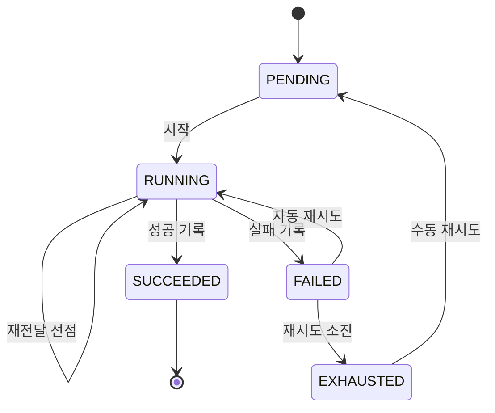

# TransCourse 도메인 모델

## TransCourse 도메인

- TransCourse는 업로드된 강의 영상의 후처리를 수행하는 시스템이다.
- 영상이 업로드되면 썸네일 생성, 메타데이터 추출, 트랜스코딩 작업이 하나씩 만들어진다.
    - 세 작업은 서로 독립적으로 실행되고 실패한다.
    - 한 작업의 실패나 재시도는 다른 작업에 영향을 주지 않는다.
- 작업은 실패하면 정해진 횟수까지 자동으로 다시 실행된다.
    - 자동 재시도를 모두 소진한 작업만 수동으로 다시 실행할 수 있다.
- 같은 작업이 두 번 실행될 수 있다.
    - 나중에 시작한 시도만 결과를 기록할 수 있다.
    - 두 시도의 산출물은 같은 위치에 저장된다.
- 영상의 전체 상태는 작업들의 상태로 결정된다.

## 도메인 모델

---
### [영상 애그리거트]

### 영상(Video)
_Aggregate Root_
#### 속성
- `id`: `Long`
- `originalName`: 원본 파일명
- `filePath`: 원본 스토리지 키. 산출물 키의 기준
- `fileSize`: 원본 크기
- `durationSec`, `width`, `height`, `videoCodec`, `audioCodec`: 메타데이터 작업이 채우는 값
- `thumbnailPath`: 썸네일 작업이 채우는 키
- `playlistPath`: 트랜스코딩 작업이 채우는 HLS 플레이리스트 키
#### 규칙
- 업로드 시점에는 원본 정보만 채운다
- 산출물 키가 비어 있으면 산출물 접근을 거부한다

---
### [처리 작업 애그리거트]

### 처리 작업(ProcessingJob)
_Aggregate Root_
#### 속성
- `id`: `Long`
- `videoId`: 대상 영상 ID
- `type`: `JobType` 처리 유형
- `status`: `JobStatus` 작업 상태
- `attemptCount`: 시도 번호
- `startedAt`, `finishedAt`: 최근 시도의 시각
- `lastFailureReason`: 최근 실패 사유
#### 행위
- `static create(videoId, type)`: PENDING 작업 생성
- `start()`: 새 시도를 시작하고 시도 번호를 올린다
- `succeed(expectedAttempt)`: 성공 기록
- `fail(reason, expectedAttempt)`: 실패 기록
- `exhaust()`: 재시도 소진 기록
- `isRetryable()`: 수동 재시도 가능 여부
- `resetForManualRetry()`: 수동 재시도를 위해 PENDING으로 되돌린다
#### 규칙
- 생성 직후 상태는 PENDING, 시도 번호는 0
- PENDING, FAILED, RUNNING에서 시작할 수 있다
- RUNNING에서의 시작은 재전달된 레코드의 새 시도 선점이다
- 성공과 실패 기록은 RUNNING에서, 현재 시도 번호와 일치할 때만 가능하다
- 재시도 소진은 FAILED에서만 기록할 수 있다
- 수동 재시도는 EXHAUSTED에서만 가능하다
- 수동 재시도는 시도 번호를 되돌리지 않는다

### 처리 유형(JobType)
_Enum_
- `THUMBNAIL`: 썸네일 생성
- `METADATA`: 메타데이터 추출
- `TRANSCODING`: HLS 트랜스코딩

### 실행 결과(JobExecutionResult)
_Enum_
- `SUCCEEDED`: 처리와 성공 기록 완료
- `FAILED`: 처리 실패와 실패 기록 완료
- `SKIPPED`: 실행 가능 상태가 아니어서 처리하지 않음
- `RESULT_REJECTED`: 처리는 마쳤으나 만료된 시도라 결과 기록이 거부됨

### 전체 상태(OverallStatus)
_Enum_
- `COMPLETED`: 모든 작업이 SUCCEEDED
- `FAILED`: 하나 이상의 작업이 EXHAUSTED
- `PROCESSING`: 그 외
